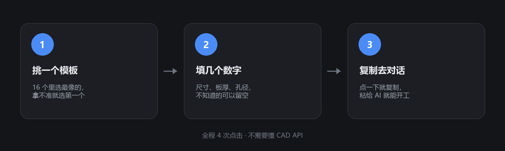
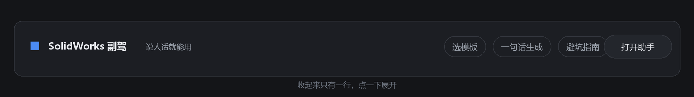
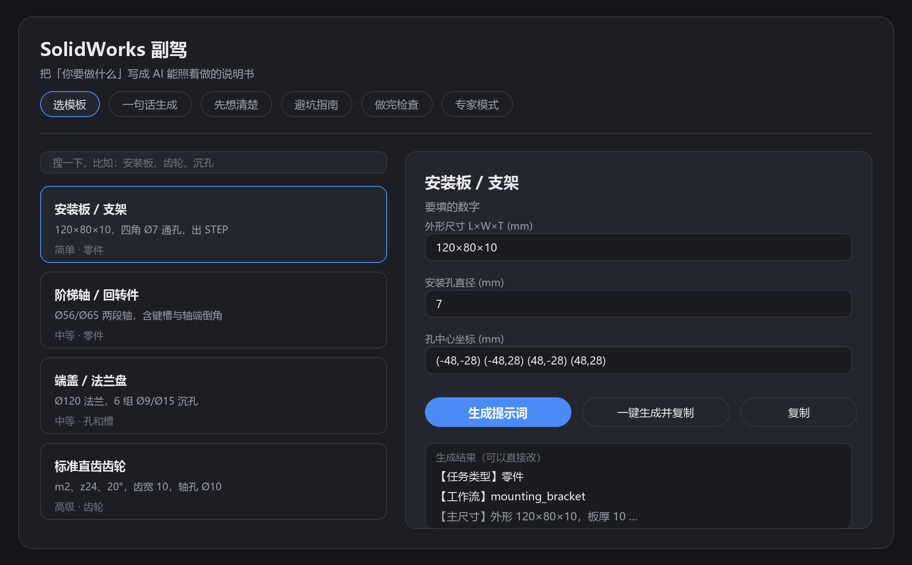
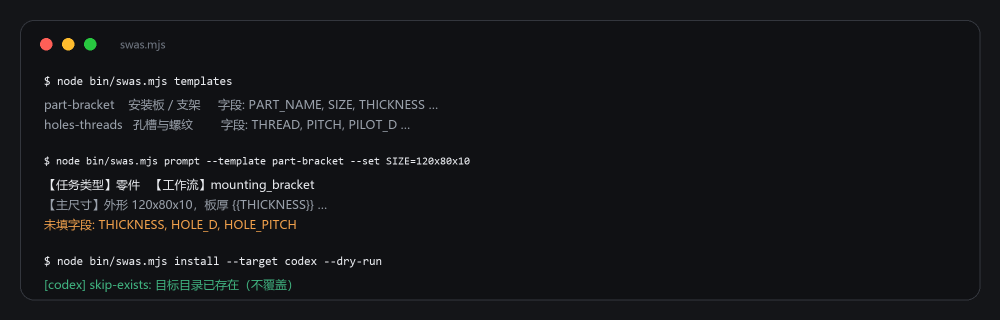

# SolidWorks Copilot for DSH

**A DSH plugin + zero-dependency CLI for the [SolidWorks Automation Skill](https://github.com/wzyn20051216/solidworks-automation-skill).**
Pick a template, fill in a few numbers, and get a spec an AI agent can actually execute — plus a one-command way to install the skill itself.

[](LICENSE)
[](licenses/UPSTREAM-MIT.txt)
[](https://github.com/topics/dsh-plugin)


**Category:** `Tools & Capabilities` (the panel also touches `UI & Experience`) · **License:** MIT · **Runtime:** DSH Desktop / Web, Node ≥ 20

**English** · [简体中文](README.md)

```bash
# one-line install (from source; no npm package required)
dsh plugin --profile web add github:redstonedust/dsh-solidworks-copilot
```

---

## Contents

- [Why this exists](#why-this-exists)
- [Three-minute quick start](#three-minute-quick-start)
- [What's inside](#whats-inside)
- [Install](#install)
- [Configuration](#configuration)
- [Permissions, external services and compatibility](#permissions-external-services-and-compatibility)
- [CLI](#cli)
- [Tools](#tools)
- [Image recognition and reasoning](#image-recognition-and-reasoning)
- [Agent presets](#agent-presets)
- [Troubleshooting](#troubleshooting)
- [Build and test](#build-and-test)
- [Fixed in 0.2.0](#fixed-in-020)
- [Scope and boundaries](#scope-and-boundaries)
- [Repository layout](#repository-layout)
- [License and attribution](#license-and-attribution)
- [About](#about)
- [Community submission checklist](#community-submission-checklist)
- [Maintenance](#maintenance)

---

## Why this exists

Telling an agent "draw me a mounting plate" produces a plate: holes in the wrong place, fillets
forgotten, nothing you can verify. The problem is not the model — it is the missing spec.

This plugin turns the spec into a reusable asset:

- **Templates** encode feature order, tolerances, acceptance evidence and prohibitions.
- **Filling blanks** is the only thing you do; anything you leave empty is reported back, never
  silently defaulted.
- **Gates** give you a checklist to run *before* anyone says "done".

---

## Three-minute quick start

You do not need to know the SolidWorks API. You need to know what the part is, how big it is, and
how many holes it has.

<p align="center">
  
</p>

### 1. Install

**Option A — DSH CLI (one line, recommended)**

```bash
dsh plugin --profile web add github:redstonedust/dsh-solidworks-copilot
```

**Option B — already inside DSH, or a local clone**

```js
plugin_manager({ action: 'install_bundle', target: '<absolute path to this repo>' })
```

Both need Full access. Refresh the page. A **SolidWorks Copilot** icon appears in the sidebar, and a
**SW Copilot** button appears on the right side of the session header.

<p align="center">
  
</p>

### 2. Pick a template

Click the sidebar icon — the **Templates** tab is already open. The 16 templates are grouped by
*part / holes / gear / sheetmetal / assembly / motion / drawing / export / inspection*, and each
card shows only two things: **difficulty** (easy · medium · advanced) and **category**.

Not sure? Take the first one, *Mounting plate / bracket*.

<p align="center">
  
</p>

### 3. Fill, generate, copy

1. Write one line about what you want (optional — the template already carries the standard wording).
2. Fill the numbers you know. Leave the rest blank; the agent will ask.
3. Press **Generate &amp; copy** — one click; **Generate prompt** only fills the preview, **Copy**
   only copies what is already there.

You get a complete spec: goal, parameter table, execution steps, acceptance evidence, hard rules,
prohibitions.

- In the sidebar page: **Copy** → paste into the chat.
- In the header popover: **Fill composer** → press Enter.

### 4. Optional: verify before you trust

Open **Checklist**, pick the work type (part / holes / assembly / motion / drawing / export) and
generate a gate list. Paste it and make the agent answer line by line. *"It's done"* is not done;
evidence is.

### No DSH? Use the CLI

<p align="center">
  
</p>

```bash
node bin/swas.mjs templates
node bin/swas.mjs prompt --template part-bracket \
  --set PART_NAME=motor-mount --set SIZE=120x80x10 --set MATERIAL=6061-T6
node bin/swas.mjs agents
node bin/swas.mjs install --target codex --dry-run
```

No dependencies, Node ≥ 20.

---

## What's inside

| Layer | What it gives you |
|---|---|
| **UI** | Sidebar workspace (7 tabs, including **Deploy**) + the **SW Copilot** button and popover in the session header, both backed by the same knowledge base |
| **7 tools** | `swas_templates` · `swas_prompt` · `swas_plan` · `swas_tips` · `swas_gate` · `swas_deploy` · `swas_status` |
| **2 agent presets** | `swas-cad` (writable modelling) · `swas-review` (read-only delivery review) |
| **Content** | 16 UI templates · 5 spec templates · 60 tips · 8 delivery gates · 9-phase design outline · 18 routing rules |
| **CLI** | `install` · `agents` · `templates` · `prompt`, pinned upstream commit, provenance, no-overwrite |

---

## Install

### Option A — as a DSH plugin (recommended)

```js
plugin_manager({ action: 'install_bundle', target: '<absolute path to this repo>' })
```

Host tools are live immediately; the panel appears after a page refresh (client modules are
composed at page start). If the result says `restart-required`, restart DSH once.

### Option B — manual mount

Place the repo at `~/.dsh/plugins/dsh-solidworks-copilot`, add a `link:` entry to the profile's
`dependencies`, add `dsh-solidworks-copilot` to `dsh.profile.bundles`, restart DSH.

### Option C — CLI only

```bash
git clone https://github.com/redstonedust/dsh-solidworks-copilot.git
cd dsh-solidworks-copilot
node bin/swas.mjs --help
```

---

## Configuration

```yaml
- id: solidworks-copilot
  name: dsh-solidworks-copilot
  config:
    skillDir: ''          # when set, SKILL_DIR in generated prompts is replaced with this path
    defaultDetail: full   # brief | full — default prompt depth
    maxTips: 12           # default result count for swas_tips
    autoFetch: false      # deploy the upstream skill at load time (off by default)
    autoFetchTarget: codex
```

`autoFetch` is **off by default** on purpose: installing a plugin should not silently hit the
network and write into your home directory.

### Deploying the skill

The panel has a **Deploy** tab: pick a client, press **Preview** (prints the plan, writes nothing),
then **Deploy**. Progress and per-client state are shown in the page, so you never need a terminal.

Pressing deploy shows a **progress bar** with the current stage and percentage:

```
starting 0% → resolving target 5% → checking existing install 12% → fetching upstream 30%
→ checking out commit 55% → verifying files 70% → writing target directory 85% → done 100%
```

The deployment runs in a child process (`bin/swas.mjs --json` emits NDJSON) and the host polls it,
so **the DSH event loop is never blocked**. On failure the bar stops at the failing stage and the log
plus copyable CLI commands appear right below.

It is backed by three loopback routes served by the plugin:

| Route | Purpose | Guard |
|---|---|---|
| `GET /swas/status` | client states + pinned ref | same-origin panel requests only |
| `POST /swas/deploy` | start a deploy job, returns `jobId` (`dryRun` defaults to `true`) | same as above |
| `GET /swas/job?id=` | job `phase` / `percent` / `lines` / `done` | same as above |

Both require `sec-fetch-site: same-origin` and `x-swas-client: ui`; without them the route answers
`403` (verified: bare `curl` → 403, panel headers → 200).

Whatever the entry point, the same rules apply: a missing `skills/` directory is skipped (never
created), an existing install with `.provenance.json` is skipped, an unmanaged directory is skipped,
and only an explicit `force` renames the old directory to `<dir>.bak-<timestamp>`.

---

## Permissions, external services and compatibility

Everything you need before installing — no hidden behaviour:

| Item | Actual behaviour |
|---|---|
| **File writes** | Only the target client's `skills/<skill>` directory (on deploy) and `.provenance.json`; nothing is ever deleted, `force` only renames a backup |
| **Local HTTP routes** | Two only: `GET /swas/status`, `POST /swas/deploy`; loopback only, and they require `sec-fetch-site: same-origin` + `x-swas-client: ui`, otherwise `403` |
| **Network** | Off by default. Traffic to `github.com` happens only when you deploy (panel **Deploy** / CLI `install` / tool `swas_deploy` with `dryRun:false`) or when `autoFetch: true` is configured |
| **External services** | No third-party APIs, no telemetry, no accounts, no usage data collected |
| **Credentials** | Never read, stored or transmitted |
| **Runtime** | DSH Desktop / Web; Node ≥ 20; deployment and modelling scripts follow Windows path practice |
| **Compatibility** | Verified on DSH Desktop `0.2.1-rc.2`; upstream content distilled from commit `2f455f2e` |

The one-line install uses the source form (`github:<owner>/<repo>`). The package is not published to
npm yet; once it is, the same place will show `dsh plugin --profile web add dsh-solidworks-copilot`.

---

## CLI

```text
node bin/swas.mjs <command> [options]

  install     deploy the upstream SolidWorks Automation Skill (default command)
  agents      list codex / claude / cursor / agents / openclaw status
  templates   list the 5 spec templates
  prompt      render a spec from a template
```

| Option | Meaning |
|---|---|
| `--target codex,claude` / `--target all` | Which clients to install into (`all` only touches clients whose skills directory exists) |
| `--ref <commit/tag/branch>` | Upstream ref, pinned to `2f455f2e` by default; validated, values starting with `-` are rejected |
| `--force` | If the target exists, rename it to `<dir>.bak-<timestamp>` first — never delete |
| `--dry-run` | Print the plan, change nothing |
| `--template <id>` `--set K=V` `--out <file>` `--strict` | `prompt` only; `--strict` exits non-zero when fields are missing |

---

## Tools

```text
swas_templates  { action: 'list' | 'get' | 'routing' | 'specs' | 'spec', id?, category?, query?, params? }
swas_prompt     { task?, template?, params?: { key: value }, detail?: 'brief' | 'full' }
swas_plan       { task?, template?, constraints? }
swas_tips       { query?, category?, limit? }
swas_gate       { workflow?, capability?, task? }
swas_deploy     { action: 'status' | 'install', target?, ref?, dryRun?, force? }
swas_status     { }
```

A typical chain:

1. `swas_deploy({ action: 'status' })` — is the skill installed at all?
2. `swas_templates({ action: 'routing', query: 'mounting plate, four M6 counterbores' })` — which script, which reference doc.
3. `swas_prompt({ task: '…', template: 'mounting-bracket', params: { size: '120×80×10' } })` — the executable spec.
4. Run it, read the evidence back, then `swas_gate({ workflow: 'mounting_bracket' })`.

---

## Image recognition and reasoning

The panel has a **Vision** tab: drop in a part photo, a SolidWorks screenshot or a drawing, and a
reasoning model extracts modelable features plus a suggested template and parameters.

Flow:

1. pick an image (PNG / JPEG / WebP / GIF, ≤ 8 MB);
2. optionally add one line of extra instructions ("focus on hole positions and thickness");
3. press **Analyze** — the host stores the image in the local attachment store, forwards it to the
   model, and returns structured JSON:
   `part / summary / template / confidence / features[] / dimensions / params / open_questions`;
4. **Generate prompt from this template** jumps to the matched template with the parsed parameters
   pre-filled; anything still missing is reported as usual.

**Reasoning pane.** Below the result there is always a *Reasoning and logs* block:

| Section | Content |
|---|---|
| Stage log | image received → attachment saved → model selected → first token → finish → JSON parsed, each with a millisecond timestamp |
| Reasoning | the model's reasoning text (when the model emits it) |
| Raw output | the unmodified answer, for comparison with the parsed result |
| Usage | input / output / reasoning tokens, elapsed time, provider and model actually used |

**Model and key.** By default it uses the **Harness default model** — i.e. the harness-managed key;
the plugin never asks you for a secret. To pin or change the model:

- edit the *Model* field in the page (`provider/model`) — applies to that request only;
- or set it in configuration:

```yaml
config:
  visionProvider: deepseek
  visionModel: deepseek-chat
  visionEffort: high   # optional reasoning effort
```

Routes (same-origin panel requests only):

| Route | Purpose |
|---|---|
| `POST /swas/vision` | image + optional model/question → features JSON, reasoning, logs |
| `GET /swas/models` | Harness default selection, providers and model list |

Privacy: the image is written to the local attachment store; it leaves the machine only when you
press **Analyze**, and only to the model provider you configured.

---

## Agent presets

Both rows ship as `@deepseek-ai/dsh-agent-preset` entries and show up in the session's agent-mode
picker once the bundle is enabled.

| Preset | Posture | Rules it enforces |
|---|---|---|
| `swas-cad` — SolidWorks · Modelling | Writable | Plan before modelling · metres everywhere · fully defined sketches · base → cut → holes → fillets · four-view preview + SHA-256 evidence |
| `swas-review` — SolidWorks · Delivery review | Read-only | Artefact list · hash reconciliation · `*_review_report.json` · four views · gate-by-gate verdict with fix actions |

Personas live in `prompts/*.md` and are compiled into `presets/*.patch.yml` by
`scripts/build-presets.mjs`.

---

## Troubleshooting

**The panel doesn't show up.** Check these four things — missing any one makes the client module
get skipped *silently*:

1. `package.json` declares `dsh.client` with `platform: "web"`.
2. `exports` contains **both** `"./client"` and `"./package.json"`. The client module table locates
   the manifest with `createRequire(...).resolve('<pkg>/package.json')`; without that export you get
   `ERR_PACKAGE_PATH_NOT_EXPORTED` and no error in the UI.
3. The package name is in the profile's `dsh.profile.bundles`.
4. The client module table is built at DSH start-up — restart once after install or upgrade.

**Self-check.** Call `swas_status` and read the *Web panel module* line. Only a `composed` result
with a resolved `client.js` path means the module actually reached the boot graph.

**The skill isn't installed.** `swas_deploy({ action: 'status' })` lists every client and its state
(`installed-by-plugin`, `unmanaged`, `not-installed`). Install with `action: 'install'`; `dryRun`
defaults to `true`.

---

## Build and test

Panel data is **baked into `client.js` at build time** (the browser half can only `require('react')`,
it cannot import local modules):

```bash
node scripts/import-content.mjs   # research JSON (_sw_pack/) → content/*.js; artefacts are committed
node scripts/build-client.mjs     # catalog.js + generate.js → client.js
node scripts/build-presets.mjs    # prompts/*.md → presets/*.patch.yml
node scripts/smoke.mjs            # real React SSR for every tab + registration contract
node scripts/selftest.mjs         # stubbed ctx: all 7 tools, happy path + edge cases
```

Re-run the relevant build after touching `catalog.js`, `content/*.js`, `prompts/*.md` or
`src/client.js`.

---

## Fixed in 0.2.0

| Bug | Symptom | Fix |
|---|---|---|
| Required and optional fields were merged | A plate missing 3 required fields reported 5 missing | `buildPrompt` returns `missing` and `optionalMissing` separately; output prints them on separate lines |
| Unknown `action` fell through to `list` | `swas_templates({ action: 'nonsense' })` looked like it worked | Explicit "unknown action + valid list" response |
| Requirement box sat below the generate button | You had to press Generate before you could describe the part | Moved the requirement box above the parameter block |

---

## Scope and boundaries

- Targets the [SolidWorks Automation Skill](https://github.com/wzyn20051216/solidworks-automation-skill); content distilled from commit `2f455f2e`.
- **Capability levels come from the skill's `capabilities.yaml`**: `reference_only` and `not_implemented` are never unattended deliverables, `pilot` requires human review.
- The plugin writes text and reads skill directories; it never edits model files.
- Deployment is opt-in (`autoFetch: false`), `install` defaults to `dryRun: true`, existing directories are skipped, `force` only renames a backup, upstream `install.js` is never executed.
- Real modelling still needs a properly licensed SolidWorks installation.

---

## Repository layout

```text
index.js              host half — registers the 7 tools
catalog.js            knowledge base assembly: templates, tips, gates, workflows, phases, presets
generate.js           prompt / plan / tips / gate generators (shared by host and build)
content/*.js          generated data
lib/fetch-core.mjs    deploy core: target resolution, single-ref git fetch, provenance, ref validation
lib/templates.mjs     spec templates: front matter, placeholder rendering, missing-field report
bin/swas.mjs          CLI: install / agents / templates / prompt
templates/*.md        5 spec templates
src/client.js         panel source (data placeholder)
client.js             build output — data inlined
presets/*.patch.yml   agent presets (personas compiled from prompts/*.md)
prompts/*.md          persona documents
docs/legal-analysis.md  compliance notes for fetching upstream at deploy time
scripts/              build, smoke test, selftest
licenses/UPSTREAM-MIT.txt  upstream MIT text
NOTICE                attribution, trademark and scope notes
```

---

## License and attribution

- **This repository:** MIT — see [LICENSE](LICENSE).
- **Derived content:** templates, tips, gates and prompt scaffolding under `content/`, `catalog.js`,
  `generate.js` and `templates/` are distilled from the upstream **SolidWorks Automation Skill**
  (MIT, Copyright (c) 2026 SolidWorks Automation Skill Contributors). The full upstream license ships
  as [licenses/UPSTREAM-MIT.txt](licenses/UPSTREAM-MIT.txt); the pinned source commit is recorded in
  [NOTICE](NOTICE).
- **Trademarks:** SOLIDWORKS® is a trademark of Dassault Systèmes SolidWorks Corporation. The name is
  used only to indicate compatibility. This project is not affiliated with, sponsored by, or
  endorsed by Dassault Systèmes.
- **Scope:** the plugin generates text, deploys upstream code and calls upstream scripts. It contains
  and performs no license circumvention, patching or activation bypass of any kind.

---

## About

**SolidWorks Copilot** is a companion to the [SolidWorks Automation Skill](https://github.com/wzyn20051216/solidworks-automation-skill): a **DSH plugin** (sidebar workspace + header popover + 7 agent tools) and a **zero-dependency CLI** (`install` / `agents` / `templates` / `prompt`), sharing 16 UI templates, 5 spec templates, 60 tips and 8 delivery gates. It fixes the missing-constraint problem — templates pin down feature order, tolerances and acceptance evidence, users only fill in numbers, and gates are checked before delivery; capability levels still come from the upstream `capabilities.yaml`.

The project is **100% vibe coded**: all code, docs and tests were generated by AI from natural-language requests, with humans limited to requirements, review and acceptance. Every claim is verified by execution (`smoke.mjs` renders each tab, `selftest.mjs` drives all 7 tools and edge inputs); MIT attribution, deployment off by default and `ref` validation follow normal engineering practice. The label describes provenance, not a quality guarantee.

Reading order: `index.js` → `lib/fetch-core.mjs` → `src/client.js`; to just use it, the [three-minute quick start](#three-minute-quick-start) covers everything.

---

## Community submission checklist

Against the [dsh-plugin.org](https://dsh-plugin.org/submit) listing requirements, this repository is:

- [x] Public (`redstonedust/dsh-solidworks-copilot`)
- [x] GitHub topic `dsh-plugin` added
- [x] README contains the install command: `dsh plugin --profile web add github:redstonedust/dsh-solidworks-copilot`
- [x] Plugin exports `apply(ctx)` (`export function apply` in `index.js`)
- [x] Repository root has `package.json` (`name` = `dsh-solidworks-copilot`, `version` = `0.3.0`)
- [x] License: MIT (`LICENSE`), upstream attribution in `NOTICE`
- [x] Screenshots / demo: `docs/images/*.png`
- [x] Permissions and external services: see *Permissions, external services and compatibility*
- [x] Category: `Tools & Capabilities` (also touches `UI & Experience`)

Submission metadata ready to reuse:

| Field | Value |
|---|---|
| Title | `[Plugin submission] redstonedust/dsh-solidworks-copilot — spec generator and skill deployer for SolidWorks modelling` |
| One-line value | After installing, "draw me a mounting plate" becomes a spec with parameters, feature order and acceptance evidence — and the upstream skill can be deployed from the panel. |
| Install command | `dsh plugin --profile web add github:redstonedust/dsh-solidworks-copilot` |
| Compatibility | DSH Desktop `0.2.1-rc.2`; Windows; Node ≥ 20 |
| License | MIT |
| Notes | The panel needs a refresh/restart to assemble; deployment is opt-in; real modelling needs a licensed SolidWorks |

Not published to npm yet: the hub can index the repository, but it will not appear inside DSH's
Plugin Hub until the package is on npm. After publishing, the install line becomes
`dsh plugin --profile web add dsh-solidworks-copilot`. Release steps: [RELEASING.md](RELEASING.md).

---

## Maintenance

**Nature:** a personal project, not a commercial product. **No SLA.** Maintenance happens in spare
time, with no promised response window.

**Maintained**

- functional defects, security and compliance issues;
- breaking changes in the upstream skill (the pinned ref is recorded in commit messages when bumped);
- adaptations to DSH plugin-API changes (client module assembly, agent-preset rows, local routes).

**Not offered**

- custom development, doing the modelling for you, remote deployments;
- any help with license circumvention, cracking or activation;
- guarantees that `pilot` / `reference_only` capabilities are correct — levels come from the
  upstream `capabilities.yaml`.

**Compatibility**

| Item | Status |
|---|---|
| DSH | verified on Desktop `0.2.1-rc.2`; older builds may lack `sidebar.panellist`, agent-preset rows or local routes |
| Node | ≥ 20 (the CLI has no dependencies) |
| Upstream skill | content distilled from commit `2f455f2e`; scripts renamed upstream may not match the names used here |
| Platform | the panel needs DSH Web/Desktop; deployment and modelling scripts follow Windows path practice |

**Versioning**

- `0.x`: no semantic-versioning promise; breaking changes are noted in the commit message and here;
- no separate CHANGELOG — use `git log --oneline`;
- the archived `dsh-solidworksskill-plugin` is no longer maintained; its deployer and templates now
  live in this repository.

**Known limitations**

- panel changes need a page refresh; new host routes need a DSH restart or plugin reload;
- the deploy route only accepts same-origin panel requests — scripts should use the CLI;
- 100% vibe coding: no hand-written implementation; quality comes from review and executed tests,
  not from how the code was produced.

### Testing and feedback welcome

The project is early; what it needs most is **real usage**, not more code. Try it on a real part and
send back whatever felt off — even "this sentence in the docs made no sense".

Four kinds of feedback are most useful:

| Area | What to tell us |
|---|---|
| Install and panel | Did the icon / header button appear? Does it survive a refresh or restart? Does `swas_status` report *composed*? |
| Prompt quality | After handing the generated spec to an agent, did it ask fewer questions and need fewer reworks? Which constraint was useless? |
| Deployment | Did the preview match your machine? Were `skip-exists` / `installed` the results you expected? |
| Docs | Which step was unclear, which sentence was jargon, which image did not match the UI |

Include these and you save a round trip:

```text
DSH version:
OS: Windows / macOS / Linux + Node version
swas_status output:
node scripts/smoke.mjs result:
node scripts/selftest.mjs result:
Steps to reproduce / screenshot / expected vs actual:
```

Pasting a real conversation or model output (with paths and project names redacted) beats "it did
not work well".

Contributions are welcome too: new spec templates (`templates/*.md`), extra engineering tips, doc
typos, one more test assertion. Anything involving license circumvention, cracking or activation is
not accepted.
