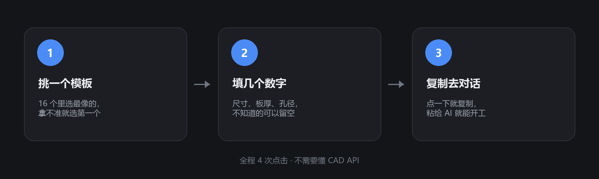
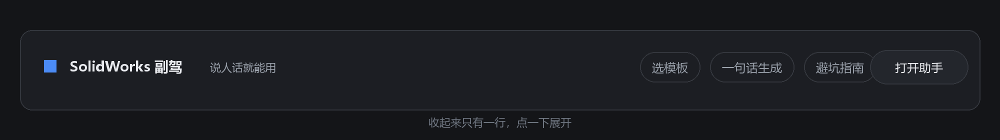
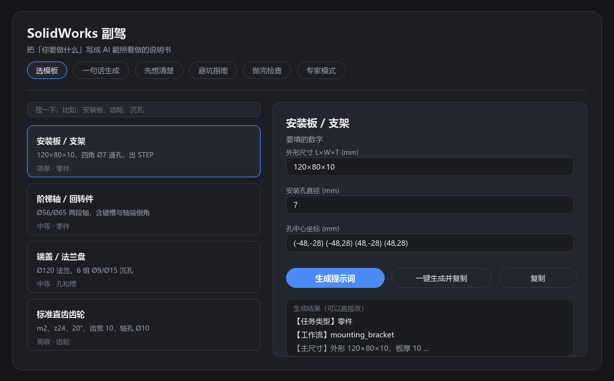
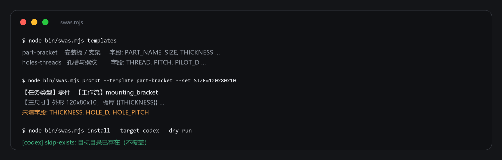

# SolidWorks 副驾 · DSH 插件

**DSH 插件 + 零依赖 CLI**：为 [SolidWorks 自动化技能](https://github.com/wzyn20051216/solidworks-automation-skill) 配一个随叫随到的助手。
选个模板、填几个数字，拿到一份 AI 能照着做的需求书；缺技能，顺手一条命令装好。

[](LICENSE)
[](licenses/UPSTREAM-MIT.txt)
[](https://github.com/topics/dsh-plugin)


**分类**：`Tools & Capabilities`（工具与能力；面板属 `UI & Experience`）· **许可**：MIT · **运行时**：DSH Desktop / Web，Node ≥ 20

**简体中文** · [English](README.en.md)

```bash
# 一行安装（源码方式，无需 npm 包）
dsh plugin --profile web add github:redstonedust/dsh-solidworks-copilot
```

---

## 目录

- [为什么需要它](#为什么需要它)
- [操作说明（照着点就行）](#操作说明照着点就行)
- [里面有什么](#里面有什么)
- [安装](#安装)
- [配置](#配置)
- [CLI](#cli)
- [工具](#工具)
- [Agent 模式](#agent-模式)
- [排障](#排障)
- [构建与测试](#构建与测试)
- [0.2.0 修掉的问题](#020-修掉的问题)
- [范围与边界](#范围与边界)
- [仓库结构](#仓库结构)
- [许可与署名](#许可与署名)
- [关于](#关于)
- [社区提交清单](#社区提交清单)
- [维护说明](#维护说明)

---

## 为什么需要它

跟 AI 说「画个安装板」，它多半会给你一块板：孔位乱放、圆角忘了、做完也没法验。
问题不在模型，在于**没给约束**。

这个插件把「约束」做成可复用的东西：

- **模板**写死特征顺序、公差、验收证据和禁止项；
- 你只负责**填数字**，没填的会被点名，不会被默认值悄悄糊过去；
- **门禁**是「说完成之前」必须逐条过一遍的清单。

---

## 操作说明（照着点就行）

不需要懂 SolidWorks API。你只要知道：要做个什么、多大、几个孔。

<p align="center">
  
</p>

### 第 0 步：先看前提

| 你要做的事 | 需要准备 |
|---|---|
| 只是想拿到一份「需求书」 | 装了 DSH 就行（Desktop / Web 都可以） |
| 想让 AI 真的把零件建出来 | 本机装好 SolidWorks（2024 / 2026）并已授权；没装也能导出 STEP/STL 等开放格式 |

### 第 1 步：装上插件

**方式 A：DSH CLI（一行命令，推荐）**

```bash
dsh plugin --profile web add github:redstonedust/dsh-solidworks-copilot
```

**方式 B：已经在 DSH 里、或本地已 clone**

```js
plugin_manager({ action: 'install_bundle', target: '<本仓库绝对路径>' })
```

两者都需要 Full access。然后**刷新页面**。会出现两个入口：左侧栏的 **SolidWorks 副驾** 图标，以及输入框下方的一条小卡。

还没有装技能的话，打开面板切到 **技能部署** 页：选客户端 → 点 **预演** 看计划 → 点 **确认部署**。目录已存在会被跳过，不会覆盖你手动装的副本。

### 第 2 步：打开面板

点侧边栏图标就是整页工作台；不想离开对话，就直接用输入框下方那条：

<p align="center">
  
</p>

整页长这样（界面示意，不是截图）：

<p align="center">
  
</p>

### 第 3 步：挑模板

默认就在 **选模板**。16 个模板按 *零件 / 孔和槽 / 齿轮 / 钣金 / 装配 / 动画 / 出图 / 导出 / 检查* 分组，卡片上只写两件事：**难不难**（简单 · 中等 · 高级）和 **是什么类**。

拿不准就点第一个「安装板 / 支架」。

### 第 4 步：填数字

右侧「要填的数字」里，**知道几个填几个，不知道的留空**——AI 会回来问你要，不会自己拍一个值。

### 第 5 步：一键生成并复制

点 **一键生成并复制**（一次点完，不用先点生成再点复制）。也可以：

- **生成提示词**：只把结果放到下面的预览框，自己先看一遍；
- **复制**：只复制当前预览框里的内容。

结果是一份完整需求书：目标、参数表、执行步骤、验收证据、硬性约束、禁止项。

### 第 6 步：回对话粘贴

复制的内容直接扔进对话框发送即可。在输入框小卡里也可以点 **放进对话框**，直接写进输入框再回车。

### 第 7 步（可选）：让它先自证

切到 **做完检查**，选这次是零件 / 孔槽 / 装配 / 动画 / 出图 / 导出，生成检查清单，粘给 AI 逐条报。
*「我完成了」不算完成，附上证据才算。*

### 不装插件也能用

<p align="center">
  
</p>

```bash
node bin/swas.mjs templates
node bin/swas.mjs prompt --template part-bracket \
  --set PART_NAME=电机安装板 --set SIZE=120x80x10 --set MATERIAL=6061-T6
node bin/swas.mjs agents
node bin/swas.mjs install --target codex --dry-run
```

零依赖，Node ≥ 20。

---

## 里面有什么

| 层 | 内容 |
|---|---|
| **界面** | 侧边栏整页（7 个标签页，含「技能部署」）+ 输入框下方小卡，共用同一份知识库 |
| **7 个工具** | `swas_templates` · `swas_prompt` · `swas_plan` · `swas_tips` · `swas_gate` · `swas_deploy` · `swas_status` |
| **2 个 Agent 模式** | `swas-cad`（可写建模）· `swas-review`（只读交付复核） |
| **内容** | 16 个 UI 模板 · 5 张需求书模板 · 60 条技巧 · 8 组门禁 · 9 段设计思路 · 18 条任务路由 |
| **CLI** | `install` · `agents` · `templates` · `prompt`：钉死 commit、写 provenance、绝不覆盖已有安装 |

---

## 安装

### 方式一：作为 DSH 插件（推荐）

```js
plugin_manager({ action: 'install_bundle', target: '<本仓库绝对路径>' })
```

Host 工具立刻可用；面板在**刷新页面**后出现（Client 模块在页面启动时装配）。返回 `restart-required` 时重启一次 DSH。

### 方式二：手动挂载

把仓库放到 `~/.dsh/plugins/dsh-solidworks-copilot`，在 profile 的 `dependencies` 里加 `link:`，把包名加进 `dsh.profile.bundles`，重启 DSH。

### 方式三：只用 CLI

```bash
git clone https://github.com/redstonedust/dsh-solidworks-copilot.git
cd dsh-solidworks-copilot
node bin/swas.mjs --help
```

---

## 配置

```yaml
- id: solidworks-copilot
  name: dsh-solidworks-copilot
  config:
    skillDir: ''          # 填了就替换提示词里的 SKILL_DIR
    defaultDetail: full   # brief | full，提示词默认详细度
    maxTips: 12           # swas_tips 默认返回条数
    autoFetch: false      # 加载时是否自动部署上游技能（默认关）
    autoFetchTarget: codex
```

`autoFetch` 默认**关闭**是有意为之：装个插件不应该顺手联网、往你的 home 目录里写东西。

### 技能部署（面板 / 工具 / CLI 三条入口）

面板里有一个 **技能部署** 标签页：选客户端 → **预演**（只打印计划）→ **确认部署**（真正落盘），日志和每个客户端的状态直接显示在页面上，不需要切终端。

它由宿主的两条本地路由支撑：

| 路由 | 作用 | 保护 |
|---|---|---|
| `GET /swas/status` | 返回各客户端状态与钉死的 ref | 只接受面板发出的同源请求 |
| `POST /swas/deploy` | 执行部署（`dryRun` 默认 `true`） | 同上 |

两条路由都要求请求带 `sec-fetch-site: same-origin` 与 `x-swas-client: ui`，缺少任一直接 `403`（实测：裸 `curl` 403，带面板头 200）。

三条入口的写盘时机：

| 入口 | 怎么用 | 默认是否写盘 |
|---|---|---|
| **面板「技能部署」页** | 选 target → 预演 → 确认部署 | 预演不写；点「确认部署」才写 |
| **工具 `swas_deploy`** | 会话里调用；`action: 'status'` 只读 | **否**（`dryRun` 默认 `true`，须显式 `dryRun: false`） |
| **CLI `swas install`** | 终端执行 | 是（可加 `--dry-run` 只预演） |
| **装载插件**（`autoFetch: true`） | DSH 启动、`apply()` 之后的一轮事件循环 | 仅在配置显式设为 `true` 时；失败只记日志 |

四种方式共用同一套判断（`ensureSkill` / `installSkill`）：

1. 客户端 `skills/` 目录不存在 → 跳过，不替你创建（`skip-no-skills-dir`）；
2. 目标目录里有 `.provenance.json` → 视为本插件装过，跳过（`skip`）；
3. 目标目录存在但没有 provenance（例如你手动 `git clone` 过）→ 跳过，**不覆盖**（`skip-unmanaged` / `skip-exists`）；
4. 只有显式 `force` / `--force` 时，才会把旧目录改名成 `<dir>.bak-<时间戳>` 再装，从不删除。

打开「装载即补齐」：

```yaml
config:
  autoFetch: true
  autoFetchTarget: codex   # 支持逗号分隔，如 codex,claude
```

成功安装会在目标目录写入 `.provenance.json`，记录上游 URL、请求的 ref、解析到的 commit 与抓取时间；面板与 `swas_deploy({ action: 'status' })` 都能看到每个客户端处于 `installed-by-plugin` / `unmanaged` / `not-installed`。

> 本机当前状态：`codex` / `claude` / `agents` 三个目录都已存在但**不是**本插件装的（`unmanaged`），所以预演会显示 `skip-exists`——这是预期行为，插件不会覆盖你手动装的副本。

---

## 权限、外部服务与兼容性

安装前需要知道的全在这里，没有隐藏行为：

| 项 | 实际行为 |
|---|---|
| **文件写入** | 只写目标客户端的 `skills/<skill 名>` 目录（部署时）与 `.provenance.json`；从不删除，`force` 也只是改名备份 |
| **本地 HTTP 路由** | 仅两条：`GET /swas/status`、`POST /swas/deploy`；只监听本机回环，且要求 `sec-fetch-site: same-origin` + `x-swas-client: ui`，否则 `403` |
| **网络** | 默认**不联网**。只有你主动部署（面板「确认部署」/ CLI `install` / 工具 `swas_deploy` 且 `dryRun:false`），或把 `autoFetch` 设为 `true` 时，才访问 `github.com` 拉取上游仓库 |
| **外部服务** | 无第三方 API、无遥测、无账号体系、不收集任何使用数据 |
| **凭据** | 不读取、不存储、不上传任何密钥或令牌 |
| **运行环境** | DSH Desktop / Web；Node ≥ 20；部署与建模脚本按 Windows 路径实践编写 |
| **兼容** | 在 DSH Desktop `0.2.1-rc.2` 验证；上游技能内容按 commit `2f455f2e` 提炼 |

一行安装走的是源码方式（`github:<owner>/<repo>`）。本包尚未发布到 npm；发布后同样的位置会给出 `dsh plugin --profile web add dsh-solidworks-copilot`。

---

## CLI

```text
node bin/swas.mjs <命令> [选项]

  install     部署上游 SolidWorks 自动化技能（默认子命令）
  agents      列出 codex / claude / cursor / agents / openclaw 状态
  templates   列出 5 张需求书模板
  prompt      用模板渲染需求书
```

| 选项 | 含义 |
|---|---|
| `--target codex,claude` / `--target all` | 装到哪些客户端（`all` 只碰 skills 目录已存在的） |
| `--ref <commit/tag/分支>` | 上游 ref，默认钉死 `2f455f2e`；会校验，以 `-` 开头的值直接拒绝 |
| `--force` | 目标已存在时先改名为 `<dir>.bak-<时间戳>`，不删除 |
| `--dry-run` | 只打印计划，不改任何东西 |
| `--template <id>` `--set K=V` `--out <file>` `--strict` | 仅 `prompt`；`--strict` 有未填字段时以非零退出 |

---

## 工具

```text
swas_templates  { action: 'list' | 'get' | 'routing' | 'specs' | 'spec', id?, category?, query?, params? }
swas_prompt     { task?, template?, params?: { key: value }, detail?: 'brief' | 'full' }
swas_plan       { task?, template?, constraints? }
swas_tips       { query?, category?, limit? }
swas_gate       { workflow?, capability?, task? }
swas_deploy     { action: 'status' | 'install', target?, ref?, dryRun?, force? }
swas_status     { }
```

典型链路：

1. `swas_deploy({ action: 'status' })` —— 技能到底装了没有；
2. `swas_templates({ action: 'routing', query: '安装板，四个 M6 沉孔' })` —— 该用哪个脚本、看哪篇文档；
3. `swas_prompt({ task: '…', template: 'mounting-bracket', params: { size: '120×80×10' } })` —— 可执行需求书；
4. 跑完回读证据，最后 `swas_gate({ workflow: 'mounting_bracket' })` 过门禁。

---

## Agent 模式

两行 `@deepseek-ai/dsh-agent-preset`，bundle 启用后出现在会话的 Agent 模式选择器里。

| 模式 | 姿态 | 强制规则 |
|---|---|---|
| `swas-cad` · SolidWorks · 建模执行 | 可写 | 先方案后动手 · 一律米制 · 草图完全定义 · 基体 → 切除 → 孔槽 → 圆角 · 四视图 + SHA-256 证据 |
| `swas-review` · SolidWorks · 交付复核 | 只读 | 产物清单 · 哈希对账 · `*_review_report.json` · 四视图 · 门禁逐条判定 + 修复动作 |

人设文档在 `prompts/*.md`，由 `scripts/build-presets.mjs` 编译进 `presets/*.patch.yml`。

---

## 排障

**面板不出现。** 按这四条查——缺任何一条，Client 模块会被**静默跳过**：

1. `package.json` 里有 `dsh.client`，且 `platform` 为 `"web"`；
2. `exports` 里**同时**有 `"./client"` 与 `"./package.json"`。Client 模块表用 `createRequire(...).resolve('<pkg>/package.json')` 定位清单，缺这条会 `ERR_PACKAGE_PATH_NOT_EXPORTED`，界面上却什么都不报；
3. 包名在 profile 的 `dsh.profile.bundles` 里；
4. Client 模块表在 DSH 启动时建立——安装或升级后重启一次。

**自检。** 调 `swas_status`，看「Web 面板模块」一行；只有显示 `已装配（…/client.js）` 才算真正进了装配图。

**技能没装。** `swas_deploy({ action: 'status' })` 会列出每个客户端的状态（`installed-by-plugin` / `unmanaged` / `not-installed`）；用 `action: 'install'` 安装，`dryRun` 默认 `true`。

---

## 构建与测试

面板数据是**构建期烘焙**进 `client.js` 的（浏览器端只能 `require('react')`，不能 import 本地模块）：

```bash
node scripts/import-content.mjs   # 调研 JSON（_sw_pack/）→ content/*.js；仓库已带产物，可跳过
node scripts/build-client.mjs     # catalog.js + generate.js → client.js
node scripts/build-presets.mjs    # prompts/*.md → presets/*.patch.yml
node scripts/smoke.mjs            # 真 React SSR 渲染每个标签页 + 注册契约
node scripts/selftest.mjs         # 桩 ctx：7 个工具 + 本地部署路由（403/200/404、预演）
node scripts/check-readme.mjs     # README 自检：图片是否存在、目录锚点是否命中、语言互链
python scripts/make-readme-images.py   # 重新生成 docs/images 里的示意图（需要 Pillow）
```

改了 `catalog.js`、`content/*.js`、`prompts/*.md` 或 `src/client.js` 之后，重跑对应构建。

---

## 0.2.0 修掉的问题

| 问题 | 现象 | 修法 |
|---|---|---|
| 必填与可选混算 | 只缺 3 个必填，却报 5 个缺失 | `buildPrompt` 拆出 `missing` 与 `optionalMissing`，结果分行显示 |
| 未知 action 静默兜底 | `swas_templates({ action: 'nonsense' })` 看起来像成功了 | 显式返回「未知 action + 可用列表」 |
| 需求输入框在生成按钮下方 | 得先点生成，才看得见「你要做什么」 | 输入框上移到参数区之前 |

---

## 范围与边界

- 面向 [SolidWorks 自动化技能](https://github.com/wzyn20051216/solidworks-automation-skill)，内容按 commit `2f455f2e` 提炼。
- **能力等级以技能的 `capabilities.yaml` 为准**：`reference_only` / `not_implemented` 不得作为无人值守交付，`pilot` 需人工复核。
- 插件只生成文本、读技能目录，不修改模型文件。
- 部署是**选做**（`autoFetch: false`），`install` 默认 `dryRun: true`，目标已存在则跳过，`force` 仅备份改名，从不执行上游 `install.js`。
- 真正建模仍需要本机合法授权的 SolidWorks。

---

## 仓库结构

```text
index.js              Host 半：注册 7 个工具
catalog.js            知识库装配：模板、技巧、门禁、工作流、九段式骨架、Agent 模式
generate.js           提示词 / 思路 / 技巧 / 门禁生成器（Host 与构建期共用）
content/*.js          生成的数据
lib/fetch-core.mjs    部署核心：目标解析、单 ref 拉取、provenance、ref 校验
lib/templates.mjs     需求书模板：front matter、占位符渲染、缺失字段报告
bin/swas.mjs          CLI：install / agents / templates / prompt
templates/*.md        5 张需求书模板
src/client.js         面板源码（含数据占位符）
client.js             构建产物：数据内联后的浏览器模块
presets/*.patch.yml   Agent 模式（人设由 prompts/*.md 编译）
prompts/*.md          人设文档
docs/legal-analysis.md  部署时拉取上游的合规分析
scripts/              构建、冒烟、自测
licenses/UPSTREAM-MIT.txt  上游 MIT 全文
NOTICE                衍生内容署名、商标与范围声明
```

---

## 许可与署名

- **本仓库**：MIT，见 [LICENSE](LICENSE)。
- **衍生内容**：`content/`、`catalog.js`、`generate.js`、`templates/` 中的模板、技巧、门禁与提示词骨架，提炼/改写自上游 **SolidWorks 自动化技能**（MIT，Copyright (c) 2026 SolidWorks Automation Skill Contributors）。上游许可全文随仓库提供：[licenses/UPSTREAM-MIT.txt](licenses/UPSTREAM-MIT.txt)；钉死来源 commit 记录在 [NOTICE](NOTICE)。
- **商标**：SOLIDWORKS® 是 Dassault Systèmes SolidWorks Corporation 的商标，此处仅用于指示兼容对象。本项目与 Dassault Systèmes 无隶属、赞助或背书关系。
- **范围**：插件只生成文本、部署上游代码、调用上游脚本；不含也不执行任何许可绕过、补丁或激活绕过。

---

## 关于

**SolidWorks 副驾**是 [SolidWorks 自动化技能](https://github.com/wzyn20051216/solidworks-automation-skill) 的配套项目，由两部分组成：**DSH 插件**（侧边栏工作台 + 输入框小卡 + 7 个 Agent 工具）与**零依赖 CLI**（`install` / `agents` / `templates` / `prompt`），两者共用 16 个界面模板、5 张需求书模板、60 条技巧与 8 组门禁。它解决的是「AI 建模缺约束」：模板写死特征顺序、公差与验收证据，用户只需填数字，交付前过门禁；能力等级仍以上游 `capabilities.yaml` 为准。

本项目为 **100% vibe coding**：代码、文档与测试全部由 AI 按自然语言指令生成，人工只负责需求、评审与验收，不手写实现。对外宣称的行为均经实跑验证（`smoke.mjs` 渲染各标签页，`selftest.mjs` 覆盖 7 个工具与边界输入）；上游 MIT 署名、部署默认关闭、`ref` 形态校验按常规工程处理。该标注说明实现来源，不构成质量背书。

阅读顺序：`index.js` → `lib/fetch-core.mjs` → `src/client.js`；只想使用的话，[操作说明](#操作说明照着点就行) 已覆盖全部步骤。

---

## 社区提交清单

面向 [dsh-plugin.org](https://dsh-plugin.org/submit) 的审核要求，本仓库当前状态：

- [x] 仓库公开（`redstonedust/dsh-solidworks-copilot`）
- [x] GitHub topic `dsh-plugin` 已添加
- [x] README 含安装命令：`dsh plugin --profile web add github:redstonedust/dsh-solidworks-copilot`
- [x] 插件导出 `apply(ctx)`（`index.js` 的 `export function apply`）
- [x] 仓库根目录含 `package.json`（`name` = `dsh-solidworks-copilot`，`version` = `0.3.0`）
- [x] 许可证：MIT（`LICENSE`），上游署名见 `NOTICE`
- [x] 截图 / 成品演示：`docs/images/*.png`
- [x] 权限与外部服务：见上方「权限、外部服务与兼容性」
- [x] 分类：`Tools & Capabilities`（另涉 `UI & Experience`）

提交时可直接用的信息：

| 字段 | 内容 |
|---|---|
| 标题 | `[Plugin submission] redstonedust/dsh-solidworks-copilot — SolidWorks 建模的需求书生成器与技能部署器` |
| 一行价值 | 装完后，你能把「画个安装板」变成一份带参数、特征顺序、验收证据的需求书，并在面板里一键把上游技能装到 Agent 客户端。 |
| 安装命令 | `dsh plugin --profile web add github:redstonedust/dsh-solidworks-copilot` |
| 兼容性 | DSH Desktop `0.2.1-rc.2`；Windows；Node ≥ 20 |
| 许可 | MIT |
| 已知限制 | 面板需刷新/重启后装配；默认不自动部署；上游技能需合法授权的 SolidWorks 才能真建模 |

尚未发布到 npm：因此可在本站被索引，但不会出现在 DSH 内的 Plugin Hub。发布后可换成 `dsh plugin --profile web add dsh-solidworks-copilot`。

---

## 维护说明

**性质**：个人项目，非商业产品，**没有 SLA**。维护按空闲时间进行，不承诺响应时限。

**会维护**

- 功能性缺陷、安全与合规问题；
- 上游技能的破坏性变更（升级钉死 ref 时在提交信息里写明新旧 commit）；
- DSH 插件 API 变化带来的适配（Client 模块装配规则、Agent preset 行、本地路由）。

**不提供**

- 定制开发、代做模型、远程代部署；
- 任何许可绕过、破解、激活相关的协助；
- 对 `pilot` / `reference_only` 能力正确性的担保——等级以上游 `capabilities.yaml` 为准。

**兼容边界**

| 项 | 当前状态 |
|---|---|
| DSH | 在 Desktop `0.2.1-rc.2` 上验证；更早版本可能没有 `sidebar.panellist`、Agent preset 行或本地路由能力 |
| Node | ≥ 20（CLI 零依赖） |
| 上游技能 | 内容按 commit `2f455f2e` 提炼；上游新增/改名的脚本可能与本仓库提示词里的名字不一致 |
| 平台 | 面板依赖 DSH Web/Desktop；部署与建模脚本按 Windows 路径实践编写 |

**版本策略**

- 目前 `0.x`：不承诺语义化版本稳定性，破坏性改动会写进提交信息和本节；
- 没有单独的 CHANGELOG，变更看 `git log --oneline`；
- 已归档的 `dsh-solidworksskill-plugin` 不再维护，其部署与模板能力已并入本仓库。

**已知限制**

- 面板改动需要刷新页面；Host 侧新增路由需要重启 DSH 或重载插件；
- 部署路由只接受面板同源请求，脚本请走 CLI；
- 100% vibe coding：没有人工逐行实现，质量保证来自评审与实跑测试，不来自代码来源。

**反馈方式**

- 开 issue 请附：DSH 版本、`swas_status` 输出、`node scripts/smoke.mjs` 与 `selftest.mjs` 的结果；
- 安全问题请走 GitHub 的私有漏洞报告（见 `SECURITY.md`），不要开公开 issue。

### 欢迎测试与反馈

项目还在早期，最缺的不是代码，是**真实使用场景**。欢迎拿手上真实的零件试一遍，把不顺的地方丢回来——哪怕是「文档这句没看懂」。

值得反馈的四类：

| 类型 | 具体想问什么 |
|---|---|
| 安装与面板 | 装完图标/小卡是否出现；刷新或重启后是否正常；`swas_status` 是否显示「已装配」 |
| 提示词质量 | 生成的说明书交给 AI 后，是否少问关键尺寸、少返工；哪一条约束其实没用 |
| 部署 | 预演是否符合预期；`skip-exists` / `installed` 是否符合你的机器现状 |
| 文档 | 哪一步看不懂、哪句像黑话、哪张图和实际界面对不上 |

反馈时附上这些，能省一轮来回：

```text
DSH 版本：
系统：Windows / macOS / Linux + Node 版本
swas_status 输出：
node scripts/smoke.mjs 结果：
node scripts/selftest.mjs 结果：
复现步骤 / 截图 / 期望 vs 实际：
```

也欢迎直接贴一段对话或模型输出（记得脱敏路径和项目名），比描述「效果不好」有用得多。

贡献同样欢迎：新增需求书模板（`templates/*.md`）、补充工程技巧、修文档错别字、补一条测试断言都算。涉及许可绕过、破解、激活的内容一律不接受。
